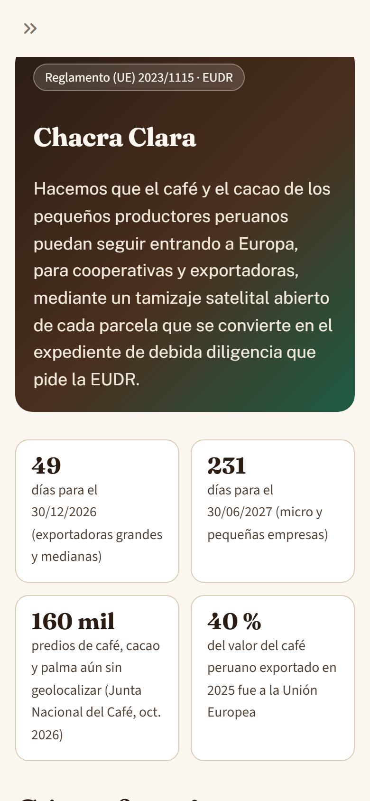
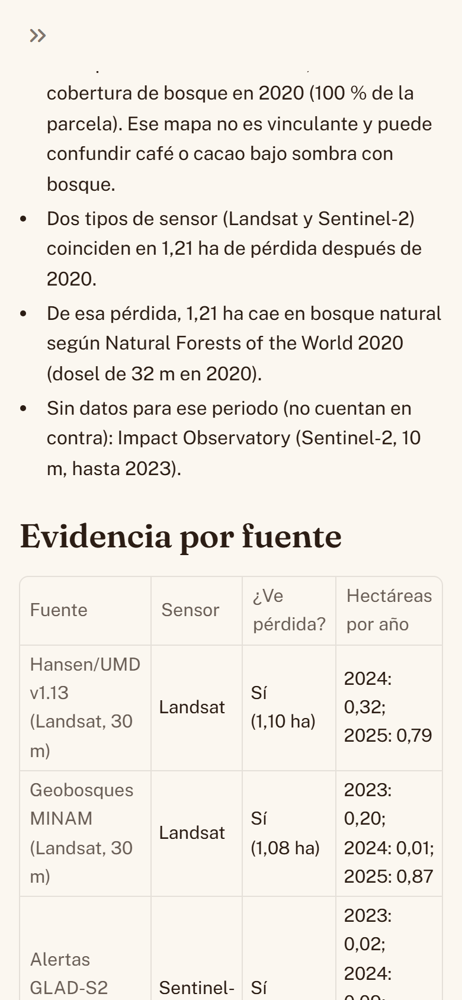
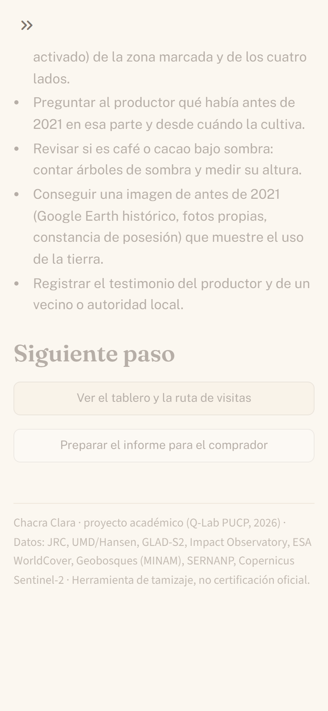
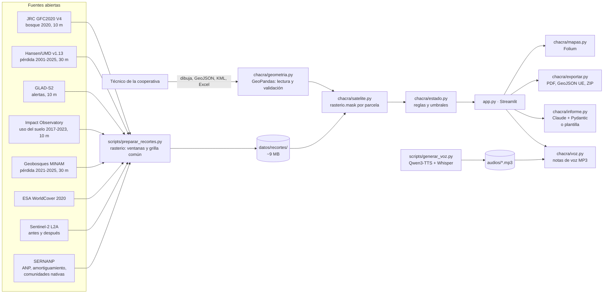

# Chacra Clara

> **Hacemos que el café y el cacao de los pequeños productores peruanos puedan seguir entrando a Europa, para cooperativas y exportadoras, mediante un tamizaje satelital abierto de cada parcela que se convierte en el expediente de debida diligencia que pide la EUDR.**

**Demo en vivo:** **https://chacra-clara.streamlit.app** (Streamlit Community Cloud) · **Video de respaldo (66 s, grabado con Playwright y narrado con mi voz clonada por IA):** [`video/demo_respaldo.mp4`](video/demo_respaldo.mp4) · Proyecto final de la Diplomatura de Ciencia de Datos para las Ciencias Sociales y la Gestión Pública (Q-Lab PUCP), noviembre de 2026.

> ⚠️ Chacra Clara es una herramienta de **tamizaje** y apoyo a la debida diligencia. **No es una certificación oficial.** El resultado final lo valida un técnico.

> 🔊 **Las notas de voz y la narración del video son sintéticas.** Las generó un modelo de texto a voz (Qwen3-TTS) con la voz de Amanda Gomez clonada, **con su consentimiento**. El repo no contiene su grabación original, el audio de referencia ni archivos del modelo o de la voz (ver [Mi voz](#mi-voz)).

---

## 1. One-liner

Hacemos que el café y el cacao de los pequeños productores peruanos sigan entrando a Europa (**X**), para cooperativas y exportadoras (**Y**), mediante un tamizaje satelital abierto de cada parcela que se convierte en el expediente de debida diligencia de la EUDR (**Z**).

## 2. Founder

**Amanda Gomez.** *(Pendiente: Amanda responde cada pregunta en 2 o 3 líneas y borra las preguntas. El agente no inventó ningún dato sobre ella).*

- **¿Quién soy y qué hago hoy?** (formación, trabajo actual)
  > _[respuesta]_
- **¿Qué he construido antes que se relacione con esto?** (proyectos con datos satelitales, mapas, voz o sector agrario y público)
  > _[respuesta]_
- **¿Qué relación tengo con el café, el cacao, la selva alta o las cooperativas?** (familia, trabajo, territorio, contactos)
  > _[respuesta]_
- **¿Por qué soy la persona indicada para resolverlo ahora?**
  > _[respuesta]_
- **¿Qué aprendí en las conversaciones con usuarios que me hizo cambiar algo del producto?**
  > _[respuesta]_

## 3. Problema

**Quién lo sufre.** Las familias que producen café y cacao en la selva alta, y las cooperativas que les compran y exportan.

- El café lo producen **223 mil familias** en **427 mil hectáreas** (dato de 2023) de **16 regiones**. El **85 %** son pequeños productores de 1 a 5 ha y **solo el 30 % está asociado** ([Agraria.pe, 05/05/2026](https://agraria.pe/noticias/exportaciones-peruanas-de-cafe-sumaron-us-131-3-millones-ent-42180)). La parcela media es de **1,9 ha**. En 2024, el **35 %** de las familias cafeteras seguía en pobreza y el **75,3 %** no alcanzaba el ingreso digno ([Agraria.pe, 23/01/2026](https://agraria.pe/noticias/cafe-crece-por-expansion-del-area-sembrada-y-no-por-aumento--41533)).
- En cacao hay unas **100 mil familias**, y solo el **30 %** es socia de una organización ([AVSF y Ethiquable, 2025](https://www.avsf.org/app/uploads/2025/10/Posicion-AVSF-Ethiquable-EUDR.pdf)).
- En **Puno** hay más de **8 800 productores de café y cacao**, sobre todo en Sandia y Carabaya ([Andina, 14/11/2025](https://andina.pe/ingles/noticia-peru-midagri-fosters-implementation-of-eudr-at-puno-regional-workshop-1051927.aspx)).

**Cuánto le cuesta.**

- El Perú exportó **US$ 1 796 millones de café en 2025** ([Agraria.pe](https://agraria.pe/noticias/exportaciones-peruanas-de-cafe-sumaron-us-131-3-millones-ent-42180)). **US$ 726 millones (40,3 %)** fueron a la Unión Europea ([Expreso](https://www.expreso.com.pe/opinion/cafe-y-cacao-el-reto-europa/); verificado solo por el extracto del buscador, porque la página bloquea el acceso directo).
- El cacao y sus derivados sumaron **US$ 1 547 millones de enero a noviembre de 2025**, y el **40 %** fue a la UE ([Agraria.pe](https://agraria.pe/noticias/a-noviembre-de-2025-se-registraron-323-exportadores-de-cacao-41577)). Para todo 2025, MINCETUR reporta **US$ 1 619 millones** ([El Peruano](https://elperuano.pe/noticia/300463-peru-es-el-segundo-mayor-exportador-de-cacao-en-grano-de-latinoamerica-y-el-sexto-del-mundo)).
- El **Reglamento (UE) 2023/1115 (EUDR)** exige probar, con la geolocalización de cada parcela, que el café y el cacao no vienen de tierras deforestadas después del **31/12/2020**. Una parcela con deforestación **descalifica todo lo que sale de ella** (art. 9.1.d).
- Según la Junta Nacional del Café, **ya se vienen condicionando embarques de café a Europa**. La meta es de **400 mil polígonos** de café, cacao y palma; MIDAGRI reporta **240 mil**, así que **faltan unos 160 mil**. Las organizaciones reclaman la **falta de una plataforma adecuada y confiable para subir la información** ([Agraria.pe, 23/10/2026](https://agraria.pe/noticias/contrarreloj-160-mil-predios-de-cafe-aun-no-son-geolocalizad-43334)).
- Los riesgos sociales están documentados ([AVSF y Ethiquable, diciembre de 2025](https://www.avsf.org/app/uploads/2025/12/note-avsf-ethiquable-RDUE_ES.pdf)):
  - quedan excluidos los productores no organizados;
  - los sistemas estatales son «demasiado complejos»;
  - las grandes exportadoras acaparan los datos de los productores, y la propiedad de esos datos «no está sistemáticamente garantizada».

**Cómo lo resuelven hoy.**

- Hay **consultores** que levantan polígonos y luego **planillas Excel** que pasan de mano en mano.
- Están **AgroDigital y el Padrón de Productores** (MIDAGRI) y herramientas gratuitas como **Whisp** (FAO, código abierto) y **Global Forest Watch Pro**, que MIDAGRI ofrece sin costo a las cooperativas (ver [competencia](#competencia)).
- O, simplemente, se deja que **la exportadora decida y se quede con los datos**.

**Conversaciones con usuarios:** [`docs/research/`](docs/research/). Hay plantillas para un técnico o gerente de cooperativa ([1](docs/research/conversacion-1.md)), un productor ([2](docs/research/conversacion-2.md)) y alguien de una exportadora ([3](docs/research/conversacion-3.md)), con preguntas sobre hechos pasados según *How to Talk to Users* de YC.

> ✍️ **[PENDIENTE: AMANDA]** Completar las 3 conversaciones reales y resumir aquí lo aprendido en 3 frases. El agente no inventó ninguna respuesta.

Todas las cifras y su verificación (con citas y discrepancias encontradas) están en [`docs/research/fuentes-verificadas.md`](docs/research/fuentes-verificadas.md).

## 4. Solución e insight

**Insight.** Las cooperativas no necesitan otro sistema estatal complejo, ni un mapa satelital más: ya tienen gratis varios. Necesitan una herramienta que haga cuatro cosas:

1. Convierta las coordenadas que ya tienen en un **expediente que el comprador europeo acepte**.
2. Les diga **qué parcelas visitar primero** y qué evidencia recoger.
3. **Explique el resultado a cada productor** en su idioma y en su formato: un audio de WhatsApp, no un PDF.
4. **Deje los datos en manos de la cooperativa** y de cada productor.

La parte satelital es necesaria, pero es la parte fácil. Lo difícil es todo lo que pasa alrededor.

**Qué hace Chacra Clara** (todo funciona en el demo):

1. **Ingreso** de parcelas de tres formas:
   - dibujándolas en el mapa (polígono o punto);
   - subiendo un GeoJSON o un KML;
   - subiendo un Excel o CSV con una **plantilla descargable**.
2. **Validación** con las reglas del Sistema de Información de la UE:
   - polígono obligatorio desde 4 ha y al menos 6 decimales;
   - dentro del Perú;
   - sin autointersecciones, agujeros, duplicados ni superposiciones.
3. **Cruce con fuentes satelitales abiertas de dos tipos de sensor** (Landsat y Sentinel-2) y con capas de **bosque natural** y **altura del dosel**, y para cada parcela:
   - si había bosque, y si era bosque natural, al 31/12/2020;
   - cuánta área perdió después;
   - en qué año, según qué fuente y qué sensor.
4. **Tres estados**, nunca solo por color (ícono, texto y patrón): ✓ **Sin deforestación detectada**, ! **Revisar** y ✕ **Posible deforestación después de 2020**. Cada uno muestra un **nivel de confianza** y la **evidencia por fuente**.
5. **Mapa y tabla equivalente**, con imágenes Sentinel-2 de antes (2020) y después (2025).
6. **Tablero de la cooperativa:**
   - por estado: parcelas, % del área, % del volumen estimado y **valor de exportación en riesgo**, con supuestos citados de rendimiento y precio;
   - días que faltan para que la EUDR rija a los importadores de la UE (30/12/2026 y 30/06/2027).
7. **Ruta de visitas para el técnico**, ordenada por riesgo y cercanía, con lo que debe verificar y qué evidencia recoger.
8. **Descargas:**
   - ficha PDF por parcela;
   - reporte PDF de la cooperativa;
   - **GeoJSON con el formato del Sistema de Información de la UE (TRACES)**;
   - ZIP con todos los datos.
9. **Informe para el comprador europeo** en español e inglés. Lo redacta un LLM con salida JSON validada por un esquema, con tope de gasto, o una plantilla sin API.
10. **Nota de voz para cada productor**, con la voz de la fundadora clonada con IA. Está preparada la estructura para quechua y aimara, sin traducciones inventadas.
11. **«Sus datos son suyos»:** exportación completa en cualquier momento y nada guardado en el servidor.

## 5. Why now

- **La fecha es real y está cerca.** La EUDR se aplica desde el **30/12/2026** a operadores grandes y medianos, y desde el **30/06/2027** a micro y pequeños, según el Reglamento (UE) 2025/2650 ([AGRINFO](https://agrinfo.eu/book-of-reports/review-of-eu-deforestation-regulation-simplification/translate/es)).
- **El Perú es país de «riesgo estándar»** ([MIDAGRI](https://www.gob.pe/institucion/midagri/noticias/1173367-midagri-the-european-commission-has-classified-peru-as-a-standard-risk-country-under-the-eudr)). Eso exige debida diligencia completa, y la exención de usar dirección postal en vez de geolocalización **no aplica**, porque es solo para países de riesgo bajo.
- **Los embarques ya se están condicionando** y faltan unos **160 mil polígonos**.
- **Hace tres años esto no era posible con datos abiertos:**
  - el mapa de bosques 2020 de la UE (JRC GFC2020, 10 m) salió en 2023 y su versión 4 es de 2025;
  - las alertas GLAD-S2 de 10 m y el uso del suelo anual de 10 m de Impact Observatory son recientes;
  - Hansen ya cubre hasta 2025;
  - todo se puede leer por ventanas (COG) sin descargar teselas enteras.
- **Los modelos actuales también lo hacen posible:** un modelo abierto clona una voz con 20 segundos de audio y corre en una laptop (Qwen3-TTS, 2025), y los LLM devuelven JSON validado por un esquema.

## 6. Demo

- **URL pública:** https://chacra-clara.streamlit.app (Streamlit Community Cloud). Probada el 10/11/2026 en tamaño de celular (390 px) y de laptop (1366 px): flujo completo y axe sin violaciones en las 7 páginas.
- **Flujo del demo (2 minutos):**
  1. En Inicio, pulse **Cargar cooperativa de ejemplo** (o dibuje una parcela, paso opcional).
  2. En Resultados, vea el mapa y la tabla.
  3. Elija **SAN-01** (posible deforestación): evidencia por fuente, imágenes de antes y después, nota de voz y descargas.
  4. Pase al **Tablero**: volumen exportable y ruta de visitas.
  5. Vuelva a **Ingresar** y dibuje una parcela nueva en el mapa.
- **Datos reales:**
  - Las capas satelitales son reales y las parcelas de ejemplo están en **ubicaciones reales** de zonas cafetaleras de Sandia y Carabaya (Puno) y Alto Mayo (San Martín), revisadas a ojo con Sentinel-2.
  - Los **productores son ficticios**: solo tienen códigos.
  - [`docs/research/parcela-real.md`](docs/research/parcela-real.md) queda listo para sumar una parcela real con consentimiento.

### Video de respaldo (plan B): cómo se produce

[`video/demo_respaldo.mp4`](video/demo_respaldo.mp4) dura 66 s y muestra el **software real funcionando**. **Nadie lo grabó a mano.** Todo lo produce código que está en este repo:

| Paso | Qué pasa | Script |
|---|---|---|
| 1. Guion de la narración | Seis frases cortas, una por escena | [`video/narracion.json`](video/narracion.json) |
| 2. Narración | Cada frase se **sintetiza** con mi voz clonada (Qwen3-TTS, sesión 15 del curso) a partir de mi muestra de voz (`voz/voz_ref.wav`, con mi consentimiento). Whisper mide el WER y, si sale mal, la regenera. **Yo no leí ni grabé la narración.** | [`scripts/generar_voz.py`](scripts/generar_voz.py) |
| 3. Pantalla | **Playwright** abre la app en un navegador sin ventana y hace los clics: portada, dibujar una parcela, resultado y evidencia, antes y después, nota de voz, tablero y descargas. Cada escena dura lo que dura su frase. | [`scripts/grabar_video.py`](scripts/grabar_video.py) (`grabar`) |
| 4. Unión | **ffmpeg** pone cada frase en el segundo en que empieza su escena, normaliza el volumen y escribe el MP4 (1280 × 720, H.264 + AAC). | [`scripts/grabar_video.py`](scripts/grabar_video.py) (`unir`) |
| 5. Un solo comando | Hace los pasos 2 a 4 desde cero, levanta la app en local y verifica que dure entre 60 y 90 s. | [`scripts/hacer_video.py`](scripts/hacer_video.py) |

El video muestra todo el tiempo el aviso «voz de Amanda generada con IA».

**Regenerar el video completo desde cero** (por ejemplo, si cambia la app antes de la presentación):

```bash
python scripts/hacer_video.py --python-voz .venv-voz/Scripts/python --desde-cero
```

Usa el entorno de la app para Playwright y ffmpeg, y el de voz (`.venv-voz`, ver abajo) para Qwen3-TTS. Toma unos 10 minutos en una laptop sin GPU. Con `--url https://…` graba contra la app publicada en vez de la local.

### Capturas (celular, 390 px)

| Inicio | Evidencia de una parcela | Tablero de la cooperativa |
|---|---|---|
|  |  |  |

Más capturas de cada página en [`docs/capturas/`](docs/capturas/).

### Cómo correrlo en local

**Un solo comando (plan B en la laptop):** en Windows, doble clic en [`correr_local.bat`](correr_local.bat), o en Linux/Mac `sh correr_local.sh`. La primera vez crea el entorno e instala todo (unos 3 minutos); después abre http://localhost:8501. Funciona sin internet una vez instalado, salvo el mapa base satelital de Esri.

Paso a paso:

```bash
git clone https://github.com/av-gomez/chacra-clara.git
cd chacra-clara
python -m venv .venv && .venv/Scripts/activate      # en Linux/Mac: source .venv/bin/activate
pip install -r requirements.txt
streamlit run app.py
```

Opcional: copie `.env.example` como `.env` y ponga `ANTHROPIC_API_KEY` para que el informe se redacte con Claude. Sin clave, se usa la plantilla. Para Streamlit Cloud, los nombres de los secretos (sin valores) están en [`docs/secretos-streamlit.md`](docs/secretos-streamlit.md). Todos son opcionales.

**¿Cabe en el plan gratuito?** Sí, con margen, así que no hizo falta comprimir ni reducir datos (medido el 10/11/2026):

| Límite | Chacra Clara |
|---|---|
| GitHub: ningún archivo de más de 100 MB | El más grande pesa 2 MB (el video). |
| Tamaño del repo | ~20 MB en total: recortes raster ~9 MB (GeoTIFF con compresión *deflate*), imágenes Sentinel-2 ~5 MB (JPEG), notas de voz ~3,4 MB (MP3 de 48 kbps), video 2 MB. |
| Memoria de Streamlit Community Cloud (alrededor de 1 GB) | La app usa unos 200 MB con las dos cooperativas cargadas y las fichas PDF generadas. |
| Datos por pantalla en celular | Mapa de resultados: ~570 KB; en **modo ligero**, ~130 KB. Cada nota de voz pesa menos de 200 KB. |

Como el plan gratuito duerme la app si nadie la usa, hay que abrirla unos minutos antes de presentar (ver el guion).

**Regenerar los datos (reproducible):**

```bash
pip install pystac-client planetary-computer odc-stac requests pillow tabulate
python scripts/preparar_recortes.py      # descarga y recorta las capas de las 3 zonas (~5 min)
python scripts/elegir_parcelas.py        # busca lugares de prueba en los datos
python scripts/preparar_demo.py          # arma las 2 cooperativas de demo y el texto de las notas de voz
python scripts/validar_metodo.py         # escribe docs/validacion/resultados.md
```

**Generar las notas de voz** (entorno aparte, porque `qwen-tts` fija su versión de `transformers`):

```bash
uv venv .venv-voz
uv pip install --python .venv-voz/Scripts/python qwen-tts faster-whisper soundfile jiwer num2words imageio-ffmpeg
# voz/voz_ref.wav: 23 s de mi voz, limpia (ver «Mi voz» abajo). No está en el repo.
.venv-voz/Scripts/python scripts/generar_voz.py
```

### Arquitectura



### Modelos, datos y APIs, y por qué

| Pieza | Qué uso | Por qué |
|---|---|---|
| Bosque en 2020 | **JRC Global Forest Cover 2020 V4**, 10 m, CC BY 4.0 | Es el mapa de referencia que publica la Comisión Europea para la EUDR. La propia Comisión aclara que es **no exclusivo y no vinculante** ([JRC](https://publications.jrc.ec.europa.eu/repository/handle/JRC142855)), por eso no es la única fuente. |
| Pérdida (1) | **Hansen/UMD Global Forest Change v1.13** (2001–2025), 30 m, CC BY 4.0 | Es la serie global más usada, con año de pérdida. La versión y el año 2025 están confirmados en la [página oficial](https://storage.googleapis.com/earthenginepartners-hansen/GFC-2025-v1.13/download.html). Sensor: Landsat. |
| Pérdida (2) | **Alertas GLAD-S2** (UMD), 10 m, solo confianza media y alta | Otro sensor (Sentinel-2) con 10 m: ve pérdidas pequeñas, que son la mayoría en el Perú. Sensor: Sentinel-2. |
| Pérdida (3) | **Impact Observatory**, uso del suelo anual (io-lulc-annual-v02), 10 m, CC BY 4.0 | Cambio de «árboles» a cultivo, suelo o pasto que se mantiene hasta 2023. **Solo llega a 2023**: no ve las pérdidas de 2024 y 2025. |
| Pérdida (4) | **Geobosques (MINAM)**, pérdida de bosque húmedo 2021-2025 | Es el dato oficial peruano. El raster original pide registro; uso la imagen pública por año de su servicio de mapas (es una máscara renderizada, no el valor original). |
| Uso del suelo 2020 | **ESA WorldCover 2020**, 10 m, CC BY 4.0 | Distingue chacra (cultivo, pasto o arbustal) de árboles para detectar renovación, poda o quema. |
| Bosque natural 2020 | **Natural Forests of the World 2020** (WRI y Google DeepMind), 10 m, CC BY 4.0, [Figshare+](https://plus.figshare.com/articles/dataset/Natural_forests_of_the_world_2020_-_probability_maps/28881731) | Separa bosque natural de plantaciones y cultivos arbóreos. Solo está en zips de 9 a 12 GB por zona UTM: el script baja un solo mosaico por rangos de bytes. **Límite:** en Sandia y Carabaya marca natural casi toda la zona; sus autores advierten que falla con agroforestería bajo sombra. |
| Altura del dosel 2020 | **ETH Global Canopy Height 2020** (Lang et al.), 10 m, CC BY 4.0 | El bosque natural de la selva alta es más alto (20 a 30 m) que la sombra del café. Con menos de 20 m donde hubo pérdida, la parcela va a «Revisar». |
| Café y cacao (no usado) | Modelos de probabilidad del **Forest Data Partnership** (2017–2025) | Serían ideales, pero están en un bucket de Google *requester pays*: hace falta una cuenta de Google Cloud con facturación o Earth Engine. Queda como mejora. |
| Evidencia visual | **Sentinel-2 L2A** (Copernicus), mediana de junio a octubre de 2020 y de 2025 | Para que el técnico vea el antes y el después. |
| Legalidad | **SERNANP** (ANP, zonas de amortiguamiento, ACP, ACR, comunidades nativas, BPP), servicio público ArcGIS | Alerta de superposición. No resuelve toda la legalidad (art. 2.40). La licencia no está declarada en el servicio: se cita «MINAM - SERNANP». |
| Descarga | **Microsoft Planetary Computer** (STAC) y lectura por ventanas sobre HTTP (GDAL `/vsicurl/`) | Gratis y sin claves. Es lo mismo que usé en la sesión 14. |
| Voz | **Qwen3-TTS-12Hz-0.6B-Base** (Apache 2.0) y **faster-whisper** para medir el WER | Es el modelo abierto de la sesión 15. Corre en mi laptop sin GPU. |
| Informe | **Claude** (`claude-opus-5-5`, configurable con `LLM_MODELO`), con salida estructurada validada por **Pydantic** | Así el JSON siempre cumple el esquema. Los números no los inventa el modelo: se le pasan calculados y se vuelven a imponer después. |
| Alertas no usadas | **RADD** (Sentinel-1) y alertas integradas de GFW | Las descargas en GeoTIFF piden clave de API (HTTP 403); las teselas PNG públicas no traen el valor original. Lo dejo como mejora. |

### Método: reglas y umbrales (versión 2)

Las reglas están en [`chacra/estado.py`](chacra/estado.py) y el cruce en [`chacra/satelite.py`](chacra/satelite.py). La versión 2 (11/11/2026) corrige un problema de fondo: la versión 1 trataba el mapa JRC como verdad y podía marcar como deforestación la **renovación de cafetales bajo sombra**. Según la Junta Nacional del Café, entre el 70 % y el 75 % del área de café del Perú necesita renovarse ([Agraria.pe, 22/08/2025](https://agraria.pe/noticias/jnc-entre-el-70-y-75-del-area-de-cafe-en-peru-requieren-reno-40483)).

1. **El JRC GFC2020 es un primer filtro, no la verdad.** La Comisión dice que no es obligatorio ni vinculante, y en la selva alta marca como bosque el café y el cacao bajo sombra (comisión sobre sistemas agroforestales).
2. **Bosque natural 2020.** Para «Posible deforestación» la pérdida tiene que caer en **bosque natural**: se usa la capa Natural Forests of the World 2020 y la altura del dosel en 2020 (ver la tabla de fuentes). Si el JRC dice bosque pero esas capas indican cultivo con sombra, la parcela va a **Revisar** con el motivo «probable café o cacao bajo sombra; la pérdida puede ser renovación o poda».
3. **Fuentes por tipo de sensor.** Hansen y Geobosques usan Landsat de 30 m con métodos parecidos: cuentan como **una** confirmación. GLAD-S2 e Impact Observatory usan Sentinel-2 (otra). «Posible» exige que coincidan **Landsat y Sentinel-2**. No hay fuente de Sentinel-1 (RADD pide clave).
4. **Periodos sin datos.** Si la pérdida es de un año que una fuente no cubre (Impact Observatory llega a 2023), esa fuente dice «sin datos para ese periodo» y **no cuenta en contra**.
5. **Área en que coinciden.** Es la **intersección** entre la pérdida vista por Landsat (Hansen o Geobosques) y la vista por Sentinel-2, con **un píxel de tolerancia** (Landsat tiene píxeles de 30 m). Nunca supera lo que ve Landsat. En la versión 1 era la **unión** de los píxeles de cualquier fuente con un vecino de otra; por eso SAN-01 daba 1,31 ha cuando las fuentes marcaban 1,10, 0,84 y 1,08 ha.
6. **Renovación declarada.** La cooperativa puede declarar el año de siembra o de la última renovación (campo opcional). Si coincide con el año de la pérdida (±1 año), la parcela va a **Revisar**.
7. **Umbrales:**
   - una fuente «ve pérdida» desde **0,1 ha** (poco más que un píxel de Landsat);
   - pérdida **significativa** desde **0,5 ha**, o desde 0,2 ha si es al menos el 10 % de la parcela (la parcela media mide 1,9 ha);
   - si ≥ 50 % de la pérdida cae donde WorldCover 2020 marcaba cultivo o pasto, va a **Revisar**.
8. **«Sin deforestación detectada» no habilita la venta.** Falta la **legalidad** (tenencia, permisos, derechos de terceros), que la app marca como pendiente. Nunca dice que una parcela «puede ir a Europa».

### Validación del método

[`scripts/validar_metodo.py`](scripts/validar_metodo.py) escribe [`docs/validacion/resultados.md`](docs/validacion/resultados.md). Usa **89 parcelas de prueba** en lugares reales de las 3 zonas, elegidas por caso: pérdida clara, una sola fuente, bosque intacto, chacra antigua, posible café bajo sombra y renovación. La auditoría de las 18 parcelas del ejemplo, antes y después del cambio de método, está en [`docs/auditoria-parcelas.md`](docs/auditoria-parcelas.md).

**Contra la revisión visual de Sentinel-2.** Interpreté a ojo 2020 contra 2025 a 10 m, sin mirar el resultado de la app ([`revision_visual.csv`](docs/validacion/revision_visual.csv)). Excluyendo 17 casos dudosos:

| Referencia visual | Método | Posible deforestación | Revisar | Sin deforestación |
|---|---|---:|---:|---:|
| Pérdida de bosque visible (9) | versión 1 | 8 | 1 | 0 |
| | **versión 2 (actual)** | **5** | **4** | **0** |
| Sin pérdida visible (63) | versión 1 | 2 | 9 | 52 |
| | **versión 2 (actual)** | **2** | **9** | **52** |

- **Aciertos:** 0 falsos negativos en las dos versiones. Toda pérdida visible queda al menos en «Revisar» y llega a la lista de visitas.
- **Lo que cambió:** con la versión 2, 4 de las 9 pérdidas visibles pasan de «Posible» a «Revisar». Son pérdidas sobre dosel bajo (probable sombra de cultivo) o vistas por un solo sensor. Es el costo esperado de un método más prudente con los productores: menos alarmas fuertes, pero ninguna pérdida queda sin visita.
- **Falsos positivos fuertes: 2** (CAR-PER-35 y ALT-PER-63). Los dos tipos de sensor ven pérdida en bosque alto, pero a ojo no se distingue en la mediana de la estación seca. Puede ser tala selectiva o pérdida en el sotobosque, o un error de las fuentes. Para eso está la visita de campo.
- **9 alarmas que se resuelven con una visita** (Revisar sin pérdida visible).

**Contra el caso buscado:** acierta 83 de 89. Esta prueba es en parte **circular**, porque los casos se eligieron con las mismas capas: solo demuestra que las reglas hacen lo que dicen. Los 6 «desaciertos» son pérdidas claras que la versión 2 manda a «Revisar» a propósito.

**Límite conocido: café y cacao bajo sombra.**
- El mapa JRC marca como bosque el 100 % de la mayoría de las parcelas de Sandia y Carabaya, y Natural Forests of the World marca como natural entre el 83 % y el 96 % de esas zonas. Ninguna de las dos capas distingue bien un cafetal bajo sombra de un bosque.
- La versión 2 usa la **altura del dosel** de 2020 (ETH, 10 m) como criterio principal: con menos de 20 m, la parcela va a «Revisar».
- Ese umbral es un criterio prudente, no una medición de campo: un cafetal con árboles de sombra altos podría seguir saliendo como «Posible», y un bosque bajo o degradado, como «Revisar».
- Los modelos de probabilidad de café y cacao del Forest Data Partnership ayudarían, pero solo se pueden descargar con una cuenta de Google Cloud con facturación.

**Otros límites:**
- **No hay verdad de campo:** la referencia es mi interpretación visual, no una visita.
- La muestra es pequeña y fue elegida con los datos, no al azar.
- A 10 m no se ve la tala selectiva.

Todo esto hay que validarlo con parcelas verificadas en campo por una cooperativa.

### Accesibilidad (WCAG 2.2 AA)

- **Estados:** nunca solo por color. Usan ícono (✓ ! ✕), texto y **patrón** (liso, rayado y punteado, en la app y en el mapa), con una paleta apta para daltonismo.
- **Mapas:** cada mapa tiene **tabla equivalente** (tablas HTML reales, no un lienzo) y un resumen en texto.
- **Navegación:** foco visible de 3 px, enlace «Saltar al contenido», jerarquía de encabezados correcta y textos alternativos en las imágenes satelitales.
- **Lectura:** lenguaje claro, sin siglas sin explicar (la Guía explica «EUDR») y texto escalable (`rem`, `clamp`).
- **Celular primero:** probado a 390 px de ancho. El **modo ligero** quita las imágenes satelitales y las capas raster. Las notas de voz pesan menos de 200 KB.
- **Audio:** es la alternativa al texto para los productores.
- **Prueba automática:** **axe-core** (vía Playwright, [`scripts/probar_app.py`](scripts/probar_app.py)) revisó las **7 páginas** en tamaño de celular y encontró **0 violaciones** ([`docs/validacion/axe.json`](docs/validacion/axe.json)). En las primeras pasadas encontró 3 problemas y los corregí:
  - orden de los encabezados;
  - tablas con desplazamiento sin acceso por teclado;
  - textos pequeños con contraste de 2,85:1, porque Streamlit les pone 60 % de opacidad. Ahora tienen 7,4:1.
- **Límite:** axe no revisa dentro del mapa (es un `iframe` de Leaflet). El mapa no es totalmente accesible con lector de pantalla; por eso existe la tabla equivalente.

### Mi voz

- **De dónde sale:** de **una sola muestra** que grabé antes del proyecto, de 28,6 s, leyendo un texto preparado (`algonuevo.m4a`, no está en el repo). Con ffmpeg recorté 23 s limpios (1,1 s a 24,1 s), filtré los graves y agudos (`highpass` 80 Hz, `lowpass` 11 kHz), reduje el ruido (`afftdn`) y normalicé el volumen (`loudnorm`, −18 LUFS): `voz/voz_ref.wav`. Su transcripción exacta (Whisper large-v3-turbo) está en [`voz/voz_ref.txt`](voz/voz_ref.txt).
- **Consentimiento:** es mi voz y lo doy. Todas las notas dicen que son de Chacra Clara, y la app indica «voz clonada con IA».
- **Control de calidad:** cada nota se genera con Qwen3-TTS y se transcribe con Whisper para calcular el WER. Si supera el 20 %, se regenera.
- **Por qué vienen pregeneradas:** el modelo pesa 2,3 GB y tarda unos 7 s por cada segundo de audio en CPU, demasiado para el servidor gratuito. Hay **notas personales** para cada parcela del demo y **notas generales** por estado y cultivo para las parcelas nuevas.
- **Todo lo que suena con mi voz es sintético:** las 24 notas y la narración del video. A partir de esa muestra, todo lo genera el modelo; no grabé ninguna otra cosa.
- **Privacidad:** el repo público **no** contiene mi grabación original, el audio de referencia limpio (`voz_ref.wav`) ni archivos del modelo o embeddings de mi voz. Están en `.gitignore`, y revisé que **nunca** se hayan subido en ningún commit. Solo están las notas ya generadas, el video y la transcripción en texto de la muestra (`voz/voz_ref.txt`), que no sirve para clonar una voz. Igual que cualquier audio público, las notas sintéticas sí podrían usarse para imitar mi voz: es un riesgo a tener en cuenta.

## 7. Modelo de negocio

**Quién paga:**

- **Exportadoras** que venden a Europa: son el «operador» que firma la declaración y el que más arriesga.
- **Cooperativas** que exportan directamente.

**El productor no paga.**

**Precio (propuesta para validar en las conversaciones):**

| Plan | Precio | Para quién |
|---|---|---|
| Gratis | S/ 0 | Organizaciones con hasta 50 parcelas (asociaciones pequeñas). |
| Por parcela | **S/ 5 por parcela verificada al año** | Cooperativas medianas. Incluye monitoreo anual, fichas, notas de voz y GeoJSON. |
| Cooperativa | **S/ 1 800 al año** (hasta 500 parcelas) | Equivale a S/ 3,60 por parcela. |
| Exportadora | **S/ 4 por parcela al año** desde 2 000 parcelas, más soporte | Exportadoras con varias cooperativas proveedoras. |

**Cuánto cuesta cada usuario (cálculo con supuestos explícitos):**

| Componente | Supuesto | Costo |
|---|---|---|
| Cómputo satelital | `rasterio.mask` sobre recortes precalculados: < 0,1 s por parcela | ≈ US$ 0,0001 por parcela |
| Recortes por zona | 0,04 grados² ≈ 9 MB y 5 min de descarga; una provincia cafetalera, 10 a 20 zonas | < US$ 1 por provincia al año (almacenamiento y cómputo) |
| Servidor | Demo: Streamlit Community Cloud (US$ 0). Producción: una VM de 2 vCPU y 4 GB, ~US$ 30 al mes, para ~20 000 parcelas | ≈ US$ 0,02 por parcela al año |
| Informe con LLM | ~3 000 tokens de entrada y ~1 500 de salida por informe. Con `claude-opus-5-5` (US$ 4 y US$ 20 por millón) = 3 000×4/10⁶ + 1 500×20/10⁶ | **US$ 0,042 por informe** (uno por lote o embarque, no por parcela). Con `claude-haiku-5-5`: ≈ US$ 0,001. Tope por sesión: US$ 0,50 |
| Nota de voz | ~25 s de audio × 7 s de CPU por segundo ≈ 3 min de CPU (~US$ 0,05 por hora) | ≈ US$ 0,003 por nota |
| **Total tecnológico** | | **≈ US$ 0,03 por parcela al año (S/ 0,11)** frente a S/ 4–5 de precio |

El costo que manda **no es la tecnología**: es el **acompañamiento** (capacitar al técnico, atender dudas y revisar casos). Ese costo cae a medida que las fichas y la guía se explican solas.

## 8. Herramientas del curso

| Herramienta | Sesión | Dónde está en el producto | Por qué esa |
|---|---|---|---|
| **Raster y datos satelitales** (rasterio, ventanas, reproyección, estadística zonal con `mask`, `nodata`, áreas en metros) | 07 (y 14) | [`chacra/satelite.py`](chacra/satelite.py) (cruce de cada parcela en vivo), [`scripts/preparar_recortes.py`](scripts/preparar_recortes.py) (descarga y recorte), [`chacra/mapas.py`](chacra/mapas.py) (capas raster en el mapa) | El problema **es** satelital: sin raster no hay forma de saber si había bosque en 2020. Uso lo de la clase: recortar con un polígono, respetar `nodata` y calcular áreas en metros y no en grados. |
| **GeoPandas y Folium** | 06 | [`chacra/geometria.py`](chacra/geometria.py) (lectura de GeoJSON, KML y Excel; validación; áreas en UTM; superposiciones), [`chacra/mapas.py`](chacra/mapas.py) (mapa de ingreso con dibujo, mapa de resultados con patrones, capas y alertas), [`chacra/cooperativa.py`](chacra/cooperativa.py) (superposición con SERNANP) | La EUDR se cumple con **polígonos**. GeoPandas los valida y Folium permite dibujarlos y mostrarlos en un celular. |
| **Texto a voz con mi voz** (Qwen3-TTS y control de WER con Whisper) | 15 | [`scripts/generar_voz.py`](scripts/generar_voz.py) (genera), [`chacra/voz.py`](chacra/voz.py) (texto de cada nota y reproductor en la app), [`audios/`](audios/) | Muchos productores no leen reportes, pero sí escuchan audios de WhatsApp. Es la forma de que el resultado **le llegue al productor** y no se quede en la exportadora. |
| Extra: **LLM con salida estructurada** | 08 | [`chacra/informe.py`](chacra/informe.py) | El comprador europeo necesita un resumen en inglés. Un esquema Pydantic garantiza el formato, y la plantilla permite que el demo nunca dependa de la API. |

## 9. Qué hizo el agente

Usé **Claude Code** (Claude Opus 5.5) como agente.

**Lo que generó el agente:**

- Revisó mis repos anteriores (`incendios-peru-2026`, `salud-peru-ipress`, `tarea_3`) y las sesiones 06, 07 y 15 del curso para reutilizar el flujo de voz y de raster.
- Verificó cada cifra y cada requisito de la EUDR en su fuente, con dos subagentes en paralelo: uno para la EUDR y las cifras ([`fuentes-verificadas.md`](docs/research/fuentes-verificadas.md)) y otro para probar el acceso anónimo a cada fuente satelital. Encontró 4 cifras que no coincidían con su fuente y las corrigió.
- Escribió todo el código: la app, los módulos de `chacra/` y los scripts.
- Bajó los datos, eligió las parcelas de prueba, hizo la revisión visual y validó el método.
- Escribió las pruebas con Playwright y axe, este README, el guion y la guía de archivos.
- Limpió mi muestra de voz con ffmpeg y sintetizó con ella las 24 notas de voz.
- **Produjo el video de respaldo de punta a punta, sin intervención mía:**
  - escribió la narración ([`video/narracion.json`](video/narracion.json)) y la sintetizó con mi voz clonada ([`scripts/generar_voz.py`](scripts/generar_voz.py));
  - grabó la pantalla con Playwright y unió imagen y voz con ffmpeg ([`scripts/grabar_video.py`](scripts/grabar_video.py));
  - dejó un comando único que lo regenera todo ([`scripts/hacer_video.py`](scripts/hacer_video.py)).

**Lo que decidí yo:**

- El problema, el usuario y el enfoque (EUDR, café y cacao, datos en manos de la cooperativa y del productor).
- Las prioridades: correcto y honesto, demo en vivo, útil, accesible y profesional.
- Usar mi voz clonada (en las notas y en la narración del video) y dar mi consentimiento.
- La propuesta de precio a validar.
- Las conversaciones con usuarios.

> ✍️ **[PENDIENTE: AMANDA]** Agregar aquí cualquier decisión que tomes al revisar (cambio de nombre, de precio, de umbrales).

---

## Cómo escala

- **Usuarios:** de una cooperativa a una **central de cooperativas** (cada una ve lo suyo y la central ve el agregado) y a **exportadoras** con decenas de proveedores. Es el mismo motor; solo cambian los permisos.
- **Integraciones:**
  - importar los polígonos de **AgroDigital** cuando MIDAGRI publique un formato de intercambio (no encontré documentación pública de su exportación);
  - exportar el GeoJSON que ya cumple la especificación del **Sistema de Información de la UE** y, más adelante, subirlo por su API.
- **Otras materias primas de la EUDR:** palma aceitera (Ucayali, San Martín), madera y caucho. Cambian los umbrales y la definición de chacra, no la arquitectura.
- **Otros países con el mismo reto:** Ecuador, Colombia y Bolivia también son de riesgo estándar. Las fuentes son globales, salvo Geobosques y SERNANP, que se reemplazan por sus equivalentes nacionales.
- **Otros mercados:** compradores del Reino Unido y de EE. UU. y certificaciones privadas (Rainforest Alliance, comercio justo) que piden trazabilidad parecida.
- **Costo marginal de una parcela nueva** en una zona ya recortada: **≈ US$ 0,0001 de cómputo**. En una zona nueva hay que sumar ~5 minutos de descarga y ~9 MB por cada 0,04 grados².

## Mercado

| | Cálculo | Valor anual |
|---|---|---|
| **TAM** (Perú) | ~400 000 polígonos de café, cacao y palma que hay que geolocalizar ([JNC vía Agraria.pe](https://agraria.pe/noticias/contrarreloj-160-mil-predios-de-cafe-aun-no-son-geolocalizad-43334)) × S/ 5 | ≈ S/ 2,0 millones |
| **SAM** | Familias asociadas que venden por organizaciones: café 223 000 × 30 % ≈ 67 000; cacao 100 000 × 30 % = 30 000. Suponiendo una parcela por familia (supuesto), ~97 000 parcelas × S/ 5 | ≈ S/ 485 000 |
| **SOM** (3 años) | 10 % del SAM: ~10 000 parcelas, unas 20 cooperativas medianas | ≈ S/ 50 000 |

Es un mercado chico si se mira solo el Perú y solo la parcela. El negocio crece con las **exportadoras** (contratos anuales con soporte), con **otros países** de la región y con **otras materias primas**. Las cifras de esos mercados no están verificadas aquí, así que no las pongo.

## Competencia

Detalle y fuentes en [`fuentes-verificadas.md`](docs/research/fuentes-verificadas.md#c-mercado-y-competencia-herramientas-de-cribado-satelital-de-parcelas).

| Alternativa | Qué ofrece | En qué es distinta Chacra Clara |
|---|---|---|
| **Whisp** (FAO; código abierto, gratis vía MIDAGRI) | Convergencia de varios mapas satelitales por parcela, por API o Python | Usa la misma idea (varias fuentes), pero Chacra Clara agrega el **flujo de la cooperativa**: validación para la UE, ruta de visitas, fichas, notas de voz y lenguaje claro. Podría usar Whisp como una fuente más. |
| **Global Forest Watch Pro** (WRI; gratis para cooperativas en el Perú) | Monitoreo de áreas de abastecimiento. Su propia web dice que no es una plataforma de trazabilidad. | No tiene expediente por productor ni comunicación con el productor. |
| **Satelligence, osapiens, Koltiva, TraceX, LiveEO** | Plataformas corporativas de EUDR, con precios a medida y en inglés | Pensadas para la exportadora o el importador europeo. Chacra Clara está pensada para la **cooperativa**: en español, en celular, con audios y con los datos en manos de la cooperativa. |
| **AgroDigital / Padrón (MIDAGRI)** | Geolocalización estatal y registro de productores | Es la base, no la competencia: Chacra Clara usa esos polígonos y ayuda a convertirlos en un expediente. Las cooperativas reclaman la falta de una plataforma «adecuada y confiable» para subir la información. |

## Riesgos y límites del método

- **Falsos positivos:**
  - café bajo sombra podado, renovación o quema de chacra vistos como pérdida;
  - errores de las fuentes (2 de 63 en la validación visual).
  - Mitigación: «Posible» exige acuerdo entre fuentes; lo dudoso va a «Revisar».
- **Falsos negativos:**
  - tala selectiva, pérdidas menores a 0,1 ha o deforestación de 2021 en una parcela que el JRC no marcó como bosque en 2020;
  - nubes (Sentinel-2) en la selva alta.
- **Lo que no cubre:** legalidad completa, tenencia, derechos laborales ni consulta previa. Solo alerta de superposición con áreas protegidas y comunidades nativas.
- **Geobosques:** se usa la máscara renderizada del servicio público, no el raster original (que pide registro). Sus términos de uso no están confirmados.
- **Datos:** el demo **no guarda** nada en un servidor. Un producto real necesita almacenamiento con consentimiento y contratos de tratamiento de datos (Ley 29733 de Protección de Datos Personales).
- **Regulatorio:** la EUDR ya cambió de fecha dos veces. Si vuelve a cambiar, el valor del tamizaje se mantiene para otros mercados y certificaciones.

## Primeros usuarios, roadmap e inversión

- **Primeros usuarios:**
  - Cooperativas de Sandia y Carabaya (Puno) y de Alto Mayo (San Martín), con una prueba gratis de 50 parcelas.
  - Talleres de MIDAGRI sobre la EUDR (como el de San Juan del Oro).
  - Las organizaciones que ya trabajan con AVSF o comercio justo.
- **Roadmap:**
  1. Validar con 3 cooperativas y 300 parcelas verificadas en campo, y recalibrar los umbrales.
  2. Agregar cuentas y almacenamiento con consentimiento, e importar de AgroDigital.
  3. Notas en quechua y aimara validadas por hablantes.
  4. Funcionamiento sin conexión en el celular del técnico.
  5. Envío del GeoJSON al Sistema de Información de la UE.
- **Inversión (propuesta):** **US$ 60 000 pre-semilla para 12 meses**:
  - una persona desarrolladora;
  - una persona agrónoma de campo a medio tiempo para la validación;
  - viajes a 3 cooperativas;
  - servidor.

## Datos, licencias y créditos

- **Datos:** JRC GFC2020 V4 (CC BY 4.0), Hansen/UMD GFC v1.13 (CC BY 4.0), GLAD-S2 (UMD), Impact Observatory LULC v02 (CC BY 4.0), ESA WorldCover 2020 (CC BY 4.0) y Copernicus Sentinel-2 (datos de Copernicus 2020 y 2025), vía Microsoft Planetary Computer.
- **Datos peruanos:** Geobosques (MINAM) y SERNANP (servicios públicos, citados con atribución).
- **Límites:** distritos de [juaneladio/peru-geojson](https://github.com/juaneladio/peru-geojson) (base INEI).
- **Mapa base:** Esri World Imagery y OpenStreetMap.
- **Tipografías:** Public Sans (OFL, `assets/fuentes/OFL.txt`) y Fraunces (Google Fonts, OFL).
- **Logos:** no se usan logos ni la identidad visual de la UE, del Gobierno del Perú ni de ninguna organización real. Ninguna organización real usa ni respalda este producto. Las cooperativas del demo son **ficticias**.
- **Código:** licencia [MIT](LICENSE).

## Archivos

Guía de cada archivo, para explicar el código: [`docs/guia-archivos.md`](docs/guia-archivos.md). Checklist de entrega: [`docs/checklist-entrega.md`](docs/checklist-entrega.md). Guion de 3 minutos: [`docs/guion-presentacion.md`](docs/guion-presentacion.md).
